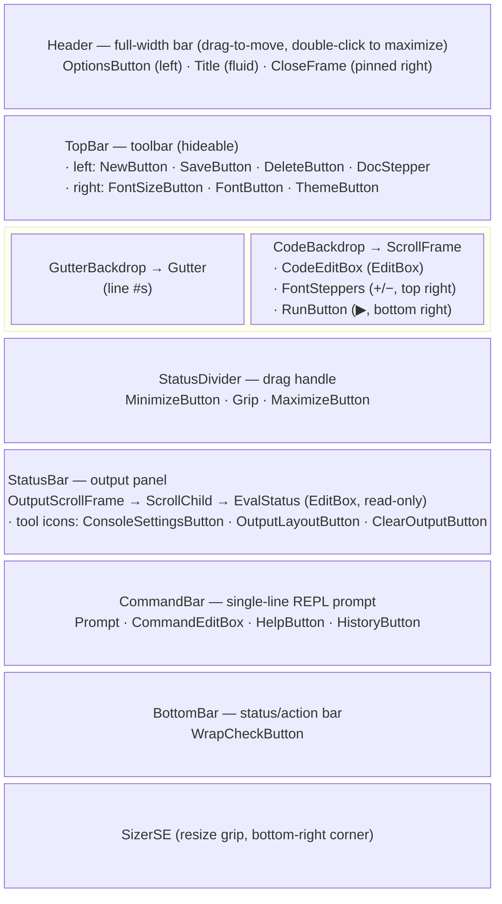

# CodeEditor

The LuaDevKit-CodeEditor addon: a line-numbered code editor dialog with an
output panel and a one-line command prompt. Settings persist through
LuaDevKit's AceDB.

## Files

| File | Role |
|---|---|
| [`CodeEditor.lua`](CodeEditor.lua) | `LDK_CodeEditor` -- the AceAddon: registers the module, opens the dialog at startup if set, and exposes `Open`/`Toggle` |
| [`CodeEditorDialog.xml`](Modules/CodeEditor/CodeEditorDialog.xml) | Frame layout (`LDK_CodeEditorDialog`) |
| [`CodeEditorDialog.lua`](Modules/CodeEditor/CodeEditorDialog.lua) | `LDK_CodeEditorDialogMixin` -- gutter sync, wrap mode, fonts, themes, toolbar, output layout, window state, documents; eval via [`LuaRunner`](../LuaDevKit/Libs/Modules/LuaRunner.lua), output kept in [`OutputLog`](../LuaDevKit/Libs/Modules/OutputLog.lua), documents kept in [`DocumentStore`](../LuaDevKit/Libs/Modules/DocumentStore.lua) |
| [`CodeEditBoxMixin.lua`](Modules/CodeEditor/CodeEditBoxMixin.lua) | Mixin for the `CodeEditBox` EditBox |
| [`CommandBarMixin.lua`](Modules/CodeEditor/CommandBarMixin.lua) | `LDK_CodeEditorCommandBarMixin` -- command line, Up/Down history, history menu, helpers button |
| [`DialogSupport.lua`](Modules/CodeEditor/DialogSupport.lua) | `ns.O.DialogSupport` -- helpers shared by the dialog and its frame mixins (`AddTooltip`) |
| [`MinimalScrollBarStyle.lua`](Modules/CodeEditor/MinimalScrollBarStyle.lua) | `ns.O.MinimalScrollBarStyle` -- restyles the code area scrollbar after MinimalScrollBar |
| [`HelpTips.xml`](Modules/HelpTips/HelpTips.xml) | Loads the files below |
| [`HelpTour.lua`](Modules/HelpTips/HelpTour.lua) | `ns.O.HelpTour` -- the editor's [LibHelpTour](https://github.com/kapresoft/wow-addon-LibHelpTour) controller, on the existing saved fields |
| [`TourList.lua`](Modules/HelpTips/TourList.lua) | Every help tour, in priority order |

Fonts are not declared in this addon.
[`FontUtil`](../LuaDevKit/Libs/Modules/FontUtil.lua) builds them at runtime with
`CreateFont`/`SetFont` from the `SharedMediaFontsMono` catalog -- one font object
per face per size in `FONT_SIZES` -- and offers a face only when it covers the
client's locale, so a CJK client sees just its Noto Sans Mono variant.
`CodeEditorDialog.xml` declares one `LDK_CodeEditorFont` placeholder so its
FontStrings have a valid font at load time; `ApplyCodeFont()` replaces it as
soon as the dialog configures. The font files come from the
[SharedMediaFontsMono](https://www.curseforge.com/wow/addons/sharedmediafontsmono)
addon, a required dependency of LuaDevKit; they are not vendored here.

## Visual layout

The dialog is a fixed-header/footer frame with the code area in between. The
output panel docks either below the code area (the default) or to its right;
the command line stays full width above the footer in both layouts. Row
order in the bottom layout, top to bottom:



<details>
<summary>Plain-text fallback</summary>

```
+-----------------------------------------------------------+
| [=]          LuaDevKit Code Editor                   [X]  |  <- Header: OptionsButton + Title (fluid) + CloseFrame
+-----------------------------------------------------------+
|  [+][S][D] < Untitled 1 >         [Size][Font][Theme]     |  <- TopBar (hideable): New/Save/Delete + DocStepper, font/theme icons
+-----------------------------------------------------------+
|   1 | CodeEditBox (EditBox)               [-][+] |  ^     |  <- body: gutter (line #s) + code area; scrollbar outside it
|   2 | ScrollFrame, inside CodeBackdrop           |  |     |
|   3 |                                        [>] |  v     |  <- RunButton: play icon in the code area's corner
+-----------------------------------------------------------+
|                    [v] =========== [^]                    |  <- StatusDivider: MinimizeButton, Grip, MaximizeButton
+-----------------------------------------------------------+
| EvalStatus (output, selectable; appended run after run)   |  <- StatusBar: output panel, tool icons in a column
+-----------------------------------------------------------+
| > CommandEditBox                                  [?][v]  |  <- CommandBar: prompt, helpers button, history menu
+-----------------------------------------------------------+
| [x] Wrap                                                  |  <- BottomBar: status/action bar
+-----------------------------------------------------------+
                                         [SizerSE resize] ->
```

</details>

`Header` splits its width by anchoring rather than arithmetic: `CloseFrame` is
pinned to the right at a fixed width, and `Title`'s `BOTTOMRIGHT` anchors to
`CloseFrame`'s `BOTTOMLEFT`, so the title absorbs whatever width is left at any
dialog size. `OptionsButton` sits at the header's left edge, in the header
rather than the toolbar, so its Show Toolbar item stays reachable. `TopBar`
anchors to `Header`'s bottom, making the header's height the only place the
header size is expressed. Only `Header` sets `enableMouse` (for drag-to-move
and double-click to maximize) -- `Title`/`CloseFrame` leave it off so a drag
started anywhere but the close button still reaches `Header`.

The bottom stack chains bottom-up: `BottomBar` pins to the dialog's bottom
edge and `CommandBar` sits on top of it. `LayoutOutputPanel()` places the rest
per layout:

- **Bottom**: `StatusBar` sits on `CommandBar` and `StatusDivider` on
  `StatusBar`, spanning the dialog. `GutterBackdrop`/`CodeBackdrop` span from
  `TopBar`'s bottom down to the divider's top.
- **Right**: `StatusBar` runs from `TopBar` down to `CommandBar` along the
  dialog's right side, with `StatusDivider` on its left edge. The code area
  spans from `TopBar` to `CommandBar` and ends at the divider.

Either way the code area is the only panel with no size of its own -- it
absorbs whatever the fixed rows and the user's chosen `StatusBar` size leave
behind. `SetStatusSize` clamps a divider drag between `MinStatusSize()` and
`MaxStatusSize()` (height in the bottom layout, width in the right one), so
neither panel can be squeezed out of existence.

## Gutter / EditBox sync

The gutter (`Gutter`) and the code area (`ScrollFrame`) are two independent
`ScrollFrame`s. Three separate mechanisms keep their rows pixel-aligned,
all in `RefreshGutter()` and its scroll/size hooks:

1. **Same font, same pitch.** `Numbers` (the gutter's EditBox) and
   `CodeEditBox` always share one font object. `ApplyCodeFont()` is the only
   place either is set, and it calls `SetFontObject` on both -- plus the
   `WrapMeasure` string -- in one pass. Since line height comes entirely from
   the font/text engine, rendering both columns' text in the identical font
   guarantees identical line pitch -- no per-line Y math is needed. This holds
   across font-size changes too: family and size together resolve to one font
   object via `FontUtil:FindFontChoice(family).bySize[size]`, so a size change
   is the same single-object swap as a family change.

2. **Same content height.** `RefreshGutter()` multiplies the rendered row
   count by `WrapMeasure.Text:GetLineHeight()` (an EditBox has no
   `GetStringHeight`), floors that at the viewport height, and applies it to
   *both* `child` (the gutter's ScrollChild) and `CodeEditBox`. Sizing both
   scroll children to the same content height gives their `ScrollFrame`s an
   identical scroll range, so a given scroll offset always corresponds to the
   same line in both. The gutter text is set *after* this, not before: the
   numbers EditBox lays out against whatever height it has at `SetText` time,
   so a layout committed against the old, shorter height stayed truncated even
   once the child grew underneath it.

3. **Locked scroll position.** The code `ScrollFrame`'s `OnVerticalScroll`
   handler (`OnCodeEditBoxScroll`) calls `self.Gutter:SetVerticalScroll(offset)`
   directly -- the gutter never scrolls on its own input; it only mirrors the
   code area's real `ScrollFrame` API, the same mechanism WoW uses for any
   scroll frame, so clipping behaves identically for both.

`RefreshGutter()` re-runs on every text change, viewport resize, wrap toggle,
font change, and programmatic `SetText` (`OnCodeEditBoxTextChanged`,
`OnCodeViewportSizeChanged`, `SetWrapText`, `ApplyCodeFont`, `SetText`), so the
three invariants above are re-established any time something could have
invalidated them.

Note the asymmetry in what triggers it. `RefreshGutter()` *writes* `CodeEditBox`'s
size, so reacting to that same box's `OnSizeChanged` would only ever be reacting
to our own writes -- a feedback edge with no external trigger behind it, which
looped every frame and (by constantly recalculating the caret) kept the text
cursor from ever rendering. That handler is deliberately not wired; only the
**ScrollFrame's** resize is, since `RefreshGutter()` never resizes the ScrollFrame.
For the same reason `OnCodeEditBoxTextChanged` bails when the text is unchanged,
and every setter inside `RefreshGutter()` is gated on `SizeDiffers` -- WoW
re-fires these events even when nothing actually changed.

**Wrap mode** adds a fourth piece: since one logical line can span multiple
*visual* rows once wrapped, `WrappedLineNumbersText()` uses the hidden
`WrapMeasure.Text` (same font and width as `CodeEditBox`) to ask
`GetNumLines()` how many visual rows each logical line will occupy, then
emits that line's number followed by `(rows - 1)` blank lines. This keeps the
gutter's row count matching the code's *visual* row count rather than its
logical line count, so numbers still land next to the correct wrapped text.

## Configuration

The dialog reads and writes LuaDevKit's AceDB directly:

- **`o:Configure()`** -- applies the saved settings: the console font, the
  editor's theme, font, size and wrap mode, toolbar visibility, output panel
  location, and the window rect (or maximized state). It never writes back.
- **`save` flag** -- `SetCodeFont`, `SetFontSize`, `SetWrapText`, `ApplyTheme`,
  `SetToolbarShown`, `SetOutputLocation` and `SetStatusSize` take an optional
  `save` argument. `true` writes the new value to the DB (user-driven changes:
  menu picks, checkbox clicks, steppers, divider drags); it is omitted for
  internal and initial sets (`OnLoad`, `Configure`, re-clamps).

`fontFamily` is a stable key into `FontUtil:GetFontChoices()` (e.g.
`'UbuntuMono'`, the catalog face name with spaces and parens stripped),
independent of the dropdown's display label so relabeling a font later won't
break persisted config; an unknown key falls back to the default face.
`fontSize` is one of `FONT_SIZES` -- `FontUtil` builds one font object per
family *per size* rather than resizing at runtime, so any other value passed
to `SetFontSize` snaps to the nearest supported size (`NearestFontSize`).

The output panel and command line share a console font. Each of its family
and size either follows the editor's (`SAME_AS_EDITOR_FONT` /
`SAME_AS_EDITOR_SIZE` in the DB) or is set on its own from the console
settings menu (`SetConsoleFont`).

## Behavior notes

- **No-wrap mode** (default): `CodeEditBox` is fixed wider than the viewport,
  so lines never reach a wrap boundary.
- **Wrap mode**: `CodeEditBox` is pinned to the `ScrollFrame` width; the gutter
  emits a blank line per extra wrapped row so numbering stays visually aligned.
- **Fonts**: changing family or size routes through `ApplyCodeFont()`, which
  calls `SetFontObject` on `CodeEditBox`, `Gutter.ScrollChild.Numbers`, and
  `WrapMeasure.Text`, then `ApplyConsoleFont()` for `EvalStatus` and
  `CommandEditBox`, since `inherits="..."` in XML only binds once at load.
  `ApplyConsoleFont()` also re-applies `EvalStatus`'s justification, which
  `SetFontObject` resets.
- **Output panel**: `EvalStatus` is a read-only multi-line `EditBox` in a plain
  `ScrollFrame` (`OutputScrollFrame`), not a `ScrollingMessageFrame`, since a
  `ScrollingMessageFrame` offers no way to select text. Output lines live in an
  `OutputLog` capped at `MAX_OUTPUT_LINES`; `RefreshOutput()` rewrites the box
  from it on every append, resize, and stray keystroke (the read-only guard in
  `OnEvalStatusTextChanged`). The panel has no scrollbar: the wheel scrolls it
  by `OUTPUT_SCROLL_LINES` rows, and `OnOutputScrollRangeChanged` snaps back to
  the newest line whenever content or size changes.
- **Output panel, bottom alignment**: the box hangs off the bottom of
  `OutputScrollFrame.ScrollChild`, which `SyncOutputHeight()` floors at the
  viewport height, so short output still sits on the panel's bottom edge. An
  `EditBox` sizes itself to its own text, so without that floor there is no
  blank space for vertical justification to act in.
- **Output panel, colors**: output keeps its `|cRRGGBBAA`/`|r` coloring, and a
  selection still pastes as plain text -- the client strips escape sequences
  when copying out of an `EditBox`, so the panel does not have to choose.
- **Font sizes**: `FontUtil` creates each catalog face at every size in
  `FONT_SIZES` (`CreateFont`/`SetFont`, named e.g.
  `LDK_CodeEditorFont_UbuntuMono_12`) and memoizes the set, so a size change is
  a font-object swap rather than a runtime resize.
